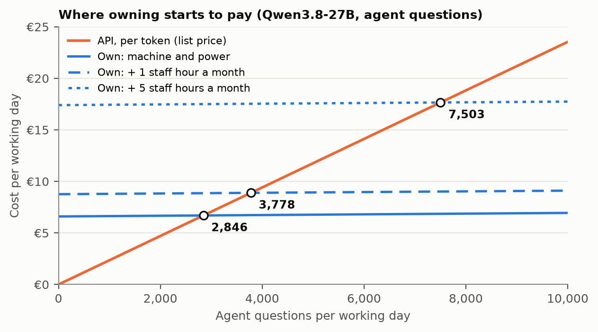
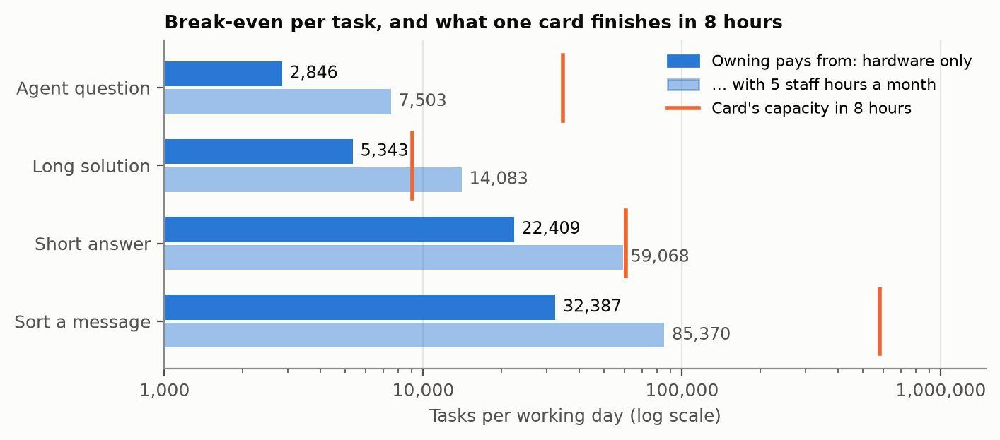

# Count Your Tasks First

**The break-even between an owned GPU and a per-token API, per task type, under a latency constraint**

Kalun Ho · November 2026 · [Website](https://kalunho.com/experiments/gpu-break-even/) · [Technical report](paper/technical_report.md) · [All tables](results/ANALYSIS.md) · follows [Cheaper Tokens, Costlier Tasks](https://github.com/kalunho17/yt-experiment-001)

<!-- TODO: add the video link once the episode is published -->

> Should a team buy a GPU for its open models, or pay an API per token? A machine you own costs
> the same every day, whether it works or waits; an API bills each task. So the answer is a number
> of tasks per day, and it depends on the task. This repository measures what decides it on one
> card, with every answer scored against a key, and releases every call that was made.



## Key findings

One RTX 5090 (32 GB) with vLLM, Qwen3.8-27B in 4-bit on four task families, gpt-oss-20b on the agent task: 84 runs, 131,939 scored tasks, 210,054 model calls, one session of 6.7 hours. Five hypotheses were written down before the runs ([docs/preregistration.md](docs/preregistration.md)); two were refuted.

| | Finding | Number |
|---|---|---|
| 1 | **Owning pays from a number of tasks per day, and agents reach it first.** Test machine against a German cloud's list price for the same model, hardware and power only | **2,846** agent questions per working day; 5,343 long solutions; 22,409 short answers; 32,387 classifications |
| 2 | **Staff time moves the line more than anything else.** Five staff hours a month cost more than the hardware | break-even **×2.6** (7,503 agent questions); a second machine ×2.0; electricity between €0.15 and €0.35 per kWh ×0.96–×1.06 |
| 3 | **One card does many times the work of one request at a time**, inside a conversational latency limit (first token ≤ 2 s, ≤ 100 ms per token, for 99% of calls) | **×2.7 to ×11.0**: 4,342 agent questions, 7,596 short answers, 1,132 long solutions per hour |
| 4 | **A busy card answers as well as an idle one.** Accuracy at the operating point against one request at a time | within **3.3 points** on all four tasks; every interval includes zero |
| 5 | **Memory, not speed, limits the larger model, and the cache did not help it** (prediction refuted). Share of the agent's input served from the prefix cache at the operating point | **0.6%** for Qwen3.8-27B (predicted ≥ 80%), 84% for gpt-oss-20b; the 27B server never ran more than 19 requests at once |
| 6 | **The smaller model has nine times the capacity and answers worse.** gpt-oss-20b against Qwen3.8-27B on agent questions | 39,800 against 4,342 per hour; **86%** against **99%** correct |

The break-even does not depend on the card's speed: it is the fixed cost per working day divided by the API's price per task. Speed and memory decide how far above the break-even one machine can go.



## The formula

```
break-even tasks per working day = fixed cost per working day ÷ (API price per task − electricity per task)
```

| Input | Test machine | Yours |
|---|--:|---|
| Machine, net of VAT | €4,423 over 3 years | `--machine`, `--years` |
| Idle power, measured at the wall | 85 W at €0.2366 per kWh | `--idle-watts`, `--eur-per-kwh` |
| Staff | 0, 1 or 5 hours a month at €45 | `--staff-hours`, `--eur-per-staff-hour` |
| Working days a year | 250 | `--working-days` |
| API price per 1M tokens, Qwen3.8-27B | €0.45 in, €0.65 out | `--input-price`, `--output-price` |
| Tokens per task | measured (table below) | from your logs |

```bash
python analysis/cost.py --machine 9000 --years 4 --staff-hours 3 --input-price 0.20 --output-price 0.80
```

| Task | Tokens in / out | API price per task | Break-even, hardware only | + 5 staff hours a month | Card's capacity in 8 hours |
|---|--:|--:|--:|--:|--:|
| Sort a message (Banking77) | 451 / 5 | €0.00021 | 32,387 | 85,370 | 578,904 |
| Short answer (GSM8K) | 105 / 403 | €0.00031 | 22,409 | 59,068 | 60,766 |
| Agent question (invoice ledger, 3 tools) | 4,678 / 382 | €0.00235 | **2,846** | 7,503 | 34,733 |
| Long solution (MATH-500 level 5) | 144 / 1,957 | €0.00134 | 5,343 | 14,083 | 9,058 |

## Repository

```
├── paper/technical_report.md      the write-up: method, results, limitations, references
├── docs/
│   ├── preregistration.md         design and hypotheses, written before the runs
│   ├── deviations.md              where the session departed from the plan
│   └── reproduce.md               run it on your own card, price it with your own numbers
├── src/gpu_break_even/            the measurement harness (Python ≥ 3.11, standard library only)
│   ├── config.py                  models, request settings, load levels, limits, prices
│   ├── load.py                    the closed-loop load runner (streamed calls, agent loop)
│   ├── sampler.py, plug.py        once-a-second GPU and queue samples; wall power
│   ├── datasets.py, prompts.py    tasks and item pools; ledger.py: the agent environment
│   ├── scoring.py                 exact-match scoring (no LLM judge)
│   ├── analysis.py                summary.json, RESULTS.md, the base cost model
│   └── cli.py                     `python run.py <command>`: check, load, smoke, night, report
├── analysis/                      make_analysis.py (intervals, hypotheses, sensitivity),
│                                  make_figures.py, cost.py (your prices), stats.py
├── data/                          benchmark files (unmodified, with SHA-256) and the reference agent questions
├── results/                       every run, task and call; per-second samples; the plug's export;
│                                  the setup record; RESULTS.md, ANALYSIS.md, numbers.json
├── figures/                       PNG + PDF
└── tests/                         unit and end-to-end tests against mock servers (no GPU)
```

## Quick start

No installation needed beyond Python 3.11+.

```bash
python run.py check                    # no GPU: data, item pools, the agent's answer keys and tools
python -m pytest                       # incl. "the published summary recomputes from the raw rows"
python run.py report                   # results/summary.json and results/RESULTS.md from the raw files
python analysis/make_analysis.py       # results/numbers.json and results/ANALYSIS.md
pip install matplotlib && python analysis/make_figures.py
```

**Re-run the measurement** on your own GPU against any OpenAI-compatible vLLM server:

```bash
vllm serve unsloth/Qwen3.8-27B-NVFP4 --served-model-name qwen3.8-27b-nvfp4 --max-model-len 32768 \
    --max-num-seqs 64 --max-cudagraph-capture-size 64 --enable-auto-tool-choice --tool-call-parser qwen3_coder
python run.py load --config Q --task T3 --level 1 16 64 --base-url http://localhost:8000/v1
python run.py night --no-conductor --config Q --base-url http://localhost:8000/v1    # the full plan
```

See [docs/reproduce.md](docs/reproduce.md) for both models, the smoke stage and wall power.

## Data and results

| File | Contents |
|---|---|
| [`results/runs.csv`](results/runs.csv) | one row per run (84): tasks per hour, latency percentiles, good calls, cache hits, queue, power |
| [`results/items.csv`](results/items.csv) | one row per task (131,939): tokens, calls, latency, correct, expected against predicted |
| [`results/calls.csv`](results/calls.csv) | one row per model call (210,054): time to first token, time per output token, tokens |
| [`results/samples.csv`](results/samples.csv) | one row per second: GPU utilisation, VRAM, running and waiting requests, KV-cache use |
| [`results/plug/`](results/plug) | the smart plug's export: power every 5 minutes, energy per hour |
| [`results/setup.md`](results/setup.md) | served models, checkpoint revisions, vLLM versions, cache configuration |
| [`results/RESULTS.md`](results/RESULTS.md), [`summary.json`](results/summary.json) | per-level tables and the base cost model |
| [`results/ANALYSIS.md`](results/ANALYSIS.md), [`numbers.json`](results/numbers.json) | the report's tables: hypotheses, 95% intervals, latency, memory, sensitivity |
| [`results/smoke/`](results/smoke) | the 20-second smoke stage run before the preregistration was committed, kept as it is |

Schemas: [results/README.md](results/README.md). Data sources and licences: [data/README.md](data/README.md).

## Limitations

One consumer GPU in a private PC, one session, two runs per level. The 27B model ran in a 4-bit build and was not compared with full precision. The 19-request ceiling is a property of the vLLM build used. The two models ran on different vLLM versions. The API side is a list price applied to token counts measured on the card; nothing was run against the API. Load was closed-loop, which is kinder than real traffic. Power comes from five-minute readings. Benchmarks stand in for work, and the agent task is synthetic. See §6 of the [report](paper/technical_report.md#6-limitations) and [docs/deviations.md](docs/deviations.md).

This is a private test bench, paid for privately, with no sponsor. The results describe this setup and the method. They are not a purchase recommendation for any card.

## Citation

```bibtex
@techreport{ho2026gpubreakeven,
  title       = {Count Your Tasks First: The Break-Even Between an Owned {GPU} and a Per-Token {API},
                 per Task Type, Under a Latency Constraint},
  author      = {Ho, Kalun},
  year        = {2026},
  month       = nov,
  type        = {Technical report},
  url         = {https://github.com/kalunho17/yt-experiment-002}
}
```

## Licence

Code: MIT ([LICENSE](LICENSE)). Results (`results/`), figures (`figures/`), report (`paper/`) and the generated agent questions (`data/generated/`): CC BY 4.0 ([LICENSE-CC-BY-4.0](LICENSE-CC-BY-4.0)).

**Datasets.** This study uses [Banking77](https://github.com/PolyAI-LDN/task-specific-datasets) (Casanueva et al., 2020; CC BY 4.0), [GSM8K](https://github.com/openai/grade-school-math) (Cobbe et al., 2021; MIT) and [MATH-500](https://github.com/openai/prm800k) (Lightman et al., 2024, a subset of MATH by Hendrycks et al., 2021; MIT). Unmodified copies are redistributed in `data/raw/` under their original licences. See [THIRD_PARTY_NOTICES](data/raw/THIRD_PARTY_NOTICES.md) and [data/README.md](data/README.md).
