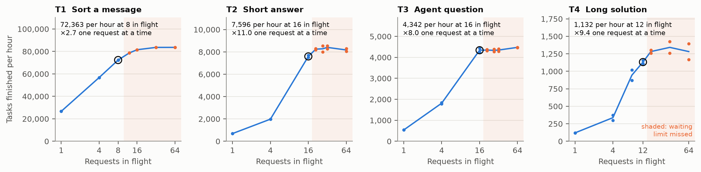
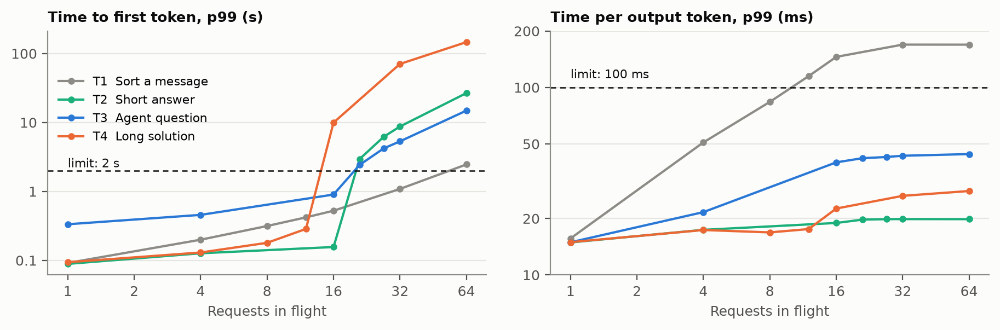
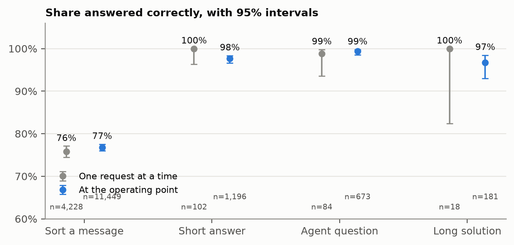
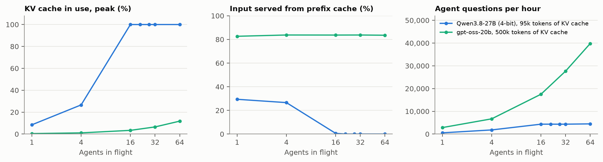
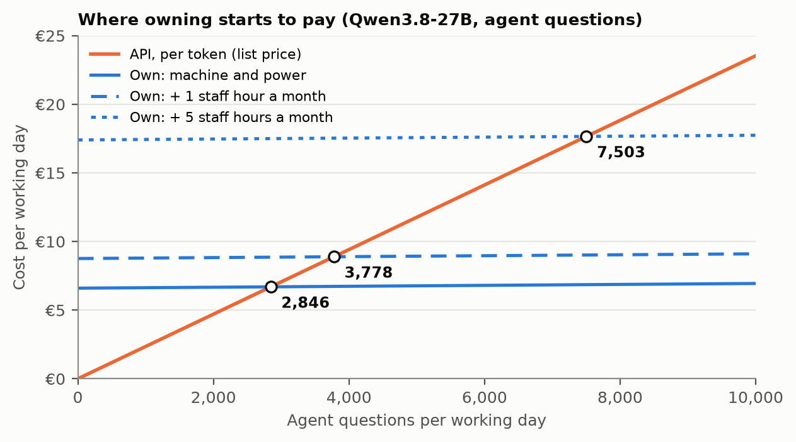
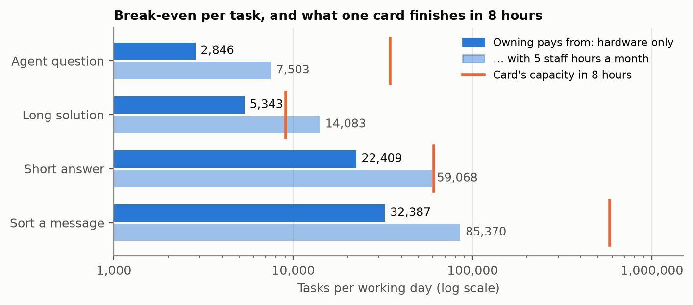
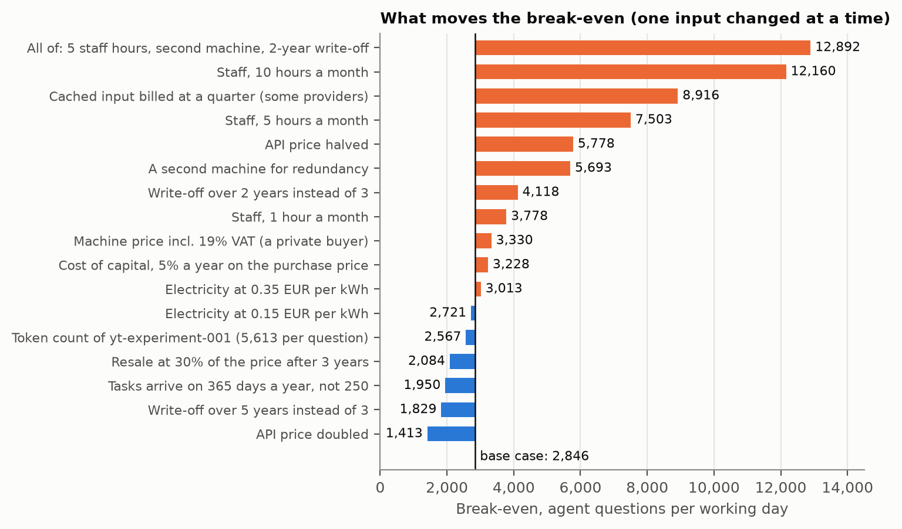

# Count Your Tasks First: The Break-Even Between an Owned GPU and a Per-Token API, per Task Type, Under a Latency Constraint

**Kalun Ho**
Technical report · November 2026 · Code, data and raw logs: this repository

---

## Abstract

Whether to buy a GPU for open-weight language models or to pay a provider per token is usually argued with prices per million tokens. For the buyer the two options have different cost shapes: an API bills each task, a machine costs the same every day whether it works or waits. The comparison therefore reduces to one number, the tasks per day above which owning is cheaper, and that number depends on the task. We measure its ingredients on one consumer GPU (RTX 5090, 32 GB, vLLM). Four task families with exact answer keys (intent classification, grade-school arithmetic, competition mathematics, a tool-using agent on a synthetic invoice ledger) are served by Qwen3.8-27B (4-bit) in closed-loop load tests from 1 to 64 requests in flight, with gpt-oss-20b as a second model on the agent task: 84 runs, 131,939 scored tasks and 210,054 model calls in one session. A load level counts only if 99% of its calls meet a conversational latency limit (first token within 2 s, then at most 100 ms per output token). Five hypotheses were written down before the runs; two were refuted. Inside the latency limit the card finished 2.7 to 11.0 times the tasks per hour of one request at a time (4,342 agent questions, 7,596 short answers, 1,132 long solutions, 72,363 classifications per hour). Accuracy at that load was within 3.3 percentage points of accuracy at one request on every task. Against the list price of a German cloud for the same model, owning the test machine breaks even at **2,846 agent questions per working day** with hardware and power only, and at 7,503 with five staff hours a month; for short answers the break-even is 22,409, for long solutions 5,343, for classification 32,387. The agent task has the lowest break-even because 89% of its API price is input, most of it context sent again at every step. The expected advantage of the owned card, a prefix cache that makes re-sent context nearly free, did not materialise for the 27B model: 0.6% of the agent's input came from cache at the operating point (predicted: at least 80%), and defeating the cache changed throughput by 3%. The model leaves room for about 95,000 tokens of key-value cache on a 32 GB card, and the server never ran more than 19 requests at once. gpt-oss-20b, with five times the cache, served 64 agents inside the limit with 84% of input from cache, at 86% accuracy against 99%. The break-even is far more sensitive to staff time, redundancy and cached-input pricing than to electricity or to the card's capacity. We release the harness, every call and item, the analysis and the preregistration.

---

## 1 Introduction

A team that has decided to run open-weight models still has to decide where. A provider's API bills per token. A machine of one's own is paid for once and then costs almost the same every day. Public discussion compares the two with a price per million tokens for each, which requires an assumption about how busy the owned machine is, and that assumption is usually left implicit [1, 2].

We turn the comparison around. Let $F$ be the fixed cost of owning per working day, $p$ the API's price for one task and $e$ the electricity one task adds on the owned machine. Owning is cheaper when the number of tasks per working day $n$ satisfies

```math
n \;>\; n^{*} \;=\; \frac{F}{p - e} .
```

$n^{*}$ is a quantity a manager can check against a log file. It depends on the task through $p$, which is the task's token count at the provider's prices. It depends on the hardware only through $F$ and $e$. The card's throughput does not enter $n^{*}$ at all. Throughput decides something else: how far above $n^{*}$ one machine can go, and whether its answers are still as fast and as good when it is that busy.

This report measures both. Our previous study measured tokens per task for the same models and tasks at one request at a time [3]; it found that an agent uses about eleven times the tokens of a single answer, 93% of them re-sent context. That finding suggests where owning should pay first, and motivates the question of this report: at how many tasks per day does an owned GPU beat a per-token API, per task type, when the owned GPU must still answer within a conversational latency limit?

Contributions:

1. **A break-even stated in tasks per working day**, per task type, with every input measured or cited, and a sensitivity analysis over the inputs a buyer would vary (§4.4, §4.5).
2. **A closed-loop load measurement under a latency constraint** on a consumer GPU: throughput, tail latency, accuracy against answer keys, cache behaviour and power, for four task families and two models (§4.1–§4.3).
3. **A preregistered design with negative results reported**: the prediction that a prefix cache makes agents cheap on an owned card was wrong for the larger model, and we trace it to key-value cache capacity (§4.3, §5).
4. **An open, dependency-free harness** with all per-call logs, so the measurement can be repeated on other hardware and priced against other providers (§7).

The test machine is a private PC with a consumer GPU. It was chosen because it was available, not because it is the right machine to buy: the method and the formula apply to any card, and the repository prices the same measurements against any price list.

## 2 Related work

**Serving throughput.** Continuous batching and paged key-value memory let one GPU serve many requests at once at little extra latency; vLLM reports two to four times the throughput of earlier systems at the same latency [4]. Gholami et al. argue that memory, not arithmetic, is increasingly the bottleneck of such workloads [5], which is why batching many requests into one pass is cheap. Throughput alone overstates what a user-facing system can deliver, so recent work reports *goodput*, the rate of requests that meet latency objectives [6]. We adopt the conversational limits of MLPerf Inference [7] and call a load level usable only if 99% of its calls meet them.

**Cost of owning against renting.** Pan et al. analyse when an on-premise deployment breaks even with commercial services [8], and Peng et al. study the inference economics of coding agents on cloud and on-premise models [9]. Patil shows that cost per token on owned accelerators depends strongly on concurrency: an under-used H100 costs 2.5 to 24 times more per output token than a busy one [10]. These works compute cost per token as a function of load. We state the result as a number of tasks per day and measure the per-task token counts and the usable capacity on the same machine, with scored answers.

**Workloads and energy.** Production traces show strong daily cycles: in Microsoft's published Azure trace, coding requests in the quietest hours fall to about 12% of the peak (our aggregation of the coding file) [11]; ServeGen characterises production workloads of a second provider [12]. An owned machine is idle in those hours; a per-token API is not billed. DynamoLLM studies energy as a function of load on inference clusters [13]. We measure whole-machine power at the wall and include idle power in the fixed cost.

**Tokens per task.** The token counts priced here extend our earlier measurement [3] from one request at a time to load, and from a fixed sample to pools of several thousand items.

## 3 Experimental setup

The design, the hypotheses and the cost model were fixed before the measured runs ([docs/preregistration.md](../docs/preregistration.md)). Departures from that plan are listed in [docs/deviations.md](../docs/deviations.md) and in §6.

### 3.1 Tasks

Four task families from [3], each scored against a key without a model as judge.

| | Task | Data | Pool | Stands for | Correct when |
|---|---|---|--:|---|---|
| T1 | Sort a message | Banking77 test set [14] | 3,080 | routing a support ticket | the intent label matches, of 77 |
| T2 | Short answer | GSM8K test set [15] | 1,319 | a multi-step calculation | the final number matches |
| T3 | Agent question | synthetic invoice ledger, three tools | unlimited | an analyst question answered by looking things up | the number matches the key computed from the ledger |
| T4 | Long solution | MATH-500, level 5, integer answers [16, 17] | 74 | a long worked answer | the integer matches |

Every run starts with the fixed sample of [3] (the *reference sample*) and then continues through the task's pool in order, starting again when the pool ends. For T3 every ledger is generated from a seed (500 invoices, 12 suppliers, four quarters) with 20 questions; the reference ledger (seed 42) comes first, then a new seed per 20 questions, so no question is asked twice and no run finds another run's context in the server's cache. The agent has three tools (list suppliers, fetch invoices, calculator) and at most 15 steps. Prompts and request settings are those of [3] (its Appendices A and B; `src/gpu_break_even/prompts.py`).

### 3.2 Models and serving

| Condition | Model | Build | Setting | vLLM | KV cache |
|---|---|---|---|---|---|
| Q | Qwen3.8-27B [18] | `unsloth/Qwen3.8-27B-NVFP4`, 4-bit | thinking off | development build `0.1.dev19754+g3a0914114` | 94,663 tokens (78 blocks of 1,568) |
| O | gpt-oss-20b [19] | `openai/gpt-oss-20b`, MXFP4 | reasoning effort low | 0.26.0 | 499,524 tokens (35,260 blocks of 16) |

One NVIDIA GeForce RTX 5090 (32,607 MiB) in a private PC, one model loaded at a time, CUDA graphs on, `--max-num-seqs 64`, context up to 32,768 tokens, prefix caching enabled. vLLM pre-allocates 90% of the card and gives what the weights leave to the key-value cache: with the model loaded, 28,020 MiB were in use for Qwen3.8-27B and 29,752 MiB for gpt-oss-20b, weights, runtime and cache together. Checkpoint revisions, versions and the cache configuration are recorded at load time in [`results/setup.md`](../results/setup.md). Condition Q ran all four tasks; condition O ran the agent task only.

The two models ran on different vLLM versions, because the 4-bit kernels of the 27B model needed a development build. Comparisons between the two conditions therefore mix model and server (§6).

### 3.3 Load procedure

Each run is a closed loop: `c` requests (agents, for T3) are in flight; when one finishes, the next item starts. A run has a 45 s ramp that is not measured and a 240 s measured window; at the end the open streams are closed, which aborts the requests on the server, and the harness waits until the server reports no running requests. All calls are streamed.

Levels were 1, 4, 16, 32 and 64 in flight, followed by two levels between the highest level that passed and the lowest that failed, with two runs per level. Stages, in one session of 6.7 hours:

- **A**: the sweep, for T3, T2, T1 and T4 on condition Q, then for T3 on condition O;
- **idle**: 3 × 5 minutes with the model loaded and no requests, per condition;
- **B**: T3 and T1 on condition Q with the prefix cache defeated, by a unique first line in every request (the server's flag cannot be changed from the client);
- **R**: T3 levels on condition Q repeated at the end, to detect drift over the session.

### 3.4 Metrics

- **Tasks per hour**: tasks finished inside the measured window, per hour.
- **Time to first token (TTFT)**: from sending a call to its first content, reasoning or tool-call token. **Time per output token (TPOT)**: (end − first token) ÷ (completion tokens − 1).
- **Good call**: TTFT ≤ 2 s and TPOT ≤ 100 ms, the conversational limits of MLPerf Inference for Llama 3.1 8B [7]. For an agent question every model call is judged.
- **A level passes** when at least 99% of its calls are good in every run. The **operating point** is the highest level that passes.
- **Accuracy**: share of tasks answered correctly among all tasks finished in a level's runs (ramp included). A truncated answer counts as wrong.
- **Tokens per task**: prompt and completion tokens summed over all calls of a task, as reported by the server.
- **Cache share**: prompt tokens served from the prefix cache ÷ prompt tokens, from the server's counters over the window.
- **Power**: whole-machine power at the wall from a smart plug (TP-Link Tapo P110). The plug was not reachable from the client during the session, so the report uses the plug's own export, one reading every five minutes (§6).

### 3.5 Cost model

All prices are net of VAT.

```math
F \;=\; \frac{\dfrac{M}{Y} + 8760\,\text{h} \cdot P_{\text{idle}} \cdot c_{\text{el}} + 12 \cdot h \cdot w}{D}, \qquad
p \;=\; \frac{t_{\text{in}}\, p_{\text{in}} + t_{\text{out}}\, p_{\text{out}}}{10^{6}}, \qquad
e \;=\; \frac{(P_{\text{op}} - P_{\text{idle}})\, c_{\text{el}}}{r_{\text{op}}}
```

| Symbol | Meaning | Value | Source |
|---|---|---|---|
| $M$ | price of the machine | €4,423 (€5,263 incl. 19% VAT) | invoices of the test PC |
| $Y$ | write-off period | 3 years | assumption |
| $P_{\text{idle}}$ | wall power, model loaded, no requests | 85 W (Q), 90 W (O) | measured |
| $c_{\text{el}}$ | electricity price | €0.2366 per kWh | Eurostat, Germany, non-household, 20–499 MWh, 2026-S1 [20] |
| $h$, $w$ | staff hours per month, cost per hour | 0, 1 or 5 h; €45.00 | the operator's own record; Destatis, labour cost per hour worked, 2025 [21] |
| $D$ | working days per year | 250 | assumption |
| $p_{\text{in}}$, $p_{\text{out}}$ | API price per million tokens | Q: €0.45, €0.65; O: €0.15, €0.25 | STACKIT AI Model Serving, list prices of 2026-11-13 [22] |
| $t_{\text{in}}$, $t_{\text{out}}$ | tokens per task | measured | this report |
| $P_{\text{op}}$, $r_{\text{op}}$ | wall power and tasks per hour at the operating point | measured | this report |

The machine is charged on every calendar day and the tasks arrive on working days, so $F$ divides the yearly cost by 250. The API prices are for the same open models, hosted in Germany; they are list prices and were not verified by running against the API. The model does not include cost of capital, resale value, a second machine for redundancy, cooling, space or the provider's free tier; §4.5 varies several of these.

### 3.6 Statistical analysis

Shares (accuracy, good calls) carry 95% Wilson score intervals [23]. The difference between accuracy at the operating point and at one request uses Newcombe's hybrid score interval for independent proportions [24], because the two levels answer different draws from the pool. Mean token counts carry normal-approximation intervals. Throughput is reported for both runs of a level. For T1 and T4 the pool is finite and repeats within a level, so the accuracy intervals there describe the variation of sampled answers over a fixed pool, not a new sample of items. The hypotheses are evaluated against their preregistered thresholds; no test was chosen after seeing the data. All intervals are computed by [`analysis/stats.py`](../analysis/stats.py) with the standard library.

## 4 Results

All tables are generated from the raw files ([`results/ANALYSIS.md`](../results/ANALYSIS.md), [`results/RESULTS.md`](../results/RESULTS.md)).

**Table 1.** Hypotheses, written before the runs.

| # | Hypothesis | Observed | Verdict |
|---|---|---|---|
| H1 | At the operating point the card finishes ≥ 10 times the tasks per hour of one request at a time (T2, T3) | T2 ×11.0, T3 ×8.0 | partly supported |
| H2 | ≥ 80% of the agent's input at the operating point comes from the prefix cache, and throughput is ≥ 2 times that without it | 0.6% from cache; throughput ×0.97 | not supported |
| H3 | Accuracy at the operating point within 5 points of accuracy at one request, T1–T4 | largest difference 3.3 points | supported |
| H4 | Break-even, hardware only: 1,500–4,000 agent questions and > 10,000 short answers per working day | 2,846 and 22,409 | supported |
| H5 | Capacity at the operating point ≥ 50 times the hardware-only break-even for agent questions | ×37 (24 h), ×12 (8 h) | not supported |

### 4.1 Throughput under a latency constraint

**Table 2.** Qwen3.8-27B: one request at a time against the operating point.

| Task | Operating point (in flight) | Tasks/h, one request | Tasks/h, operating point | Gain | TTFT p99 at the operating point | TPOT p99 |
|---|--:|--:|--:|--:|--:|--:|
| T1 Sort a message | 8 | 26,688 | 72,363 | ×2.7 | 0.32 s | 84 ms |
| T2 Short answer | 16 | 690 | 7,596 | ×11.0 | 0.16 s | 19 ms |
| T3 Agent question | 16 | 540 | 4,342 | ×8.0 | 0.90 s | 40 ms |
| T4 Long solution | 12 | 120 | 1,132 | ×9.4 | 0.29 s | 18 ms |



*Figure 1. Tasks finished per hour against requests in flight. Dots are single runs, the circle is the operating point, the shaded range misses the latency limit.*

Throughput rises almost linearly up to the operating point and is flat beyond it; only waiting grows (Figure 2). The two runs of a level agree within 5% for T1 to T3. T4, with 20 to 300 tasks per window, varies more (870 and 1,020 per hour at 8 in flight).

What ends the usable range differs by task. For classification (T1) it is time per output token: the prompt is 451 tokens and the answer 5, so the card spends its time on prompt processing, and TPOT p99 crosses 100 ms between 8 and 12 in flight while the first token still arrives in 0.4 s. For the other three tasks it is time to first token: the server stopped admitting requests at 19 running (Table 5), so beyond that level requests queue, and TTFT p99 jumps from 0.16 s at 16 in flight to 2.95 s at 21 for T2. Output rate was still scaling at that point: 66 tokens per second at one request, 854 at 16.



*Figure 2. 99th percentile of time to first token and of time per output token; dashed lines are the limits.*

The repeat at the end of the session (stage R) gave 540 and 4,379 agent questions per hour at 1 and 16 in flight against 540 and 4,342 in the first pass (+0.9%), so the session did not drift.

### 4.2 Accuracy under load

**Table 3.** Qwen3.8-27B: accuracy with 95% intervals.

| Task | One request (n) | Operating point (n) | Difference, points |
|---|--:|--:|--:|
| T1 Sort a message | 75.8% [74.5, 77.1] (4,228) | 76.8% [76.0, 77.6] (11,449) | +1.0 [−0.5, +2.5] |
| T2 Short answer | 100.0% [96.4, 100.0] (102) | 97.7% [96.6, 98.4] (1,196) | −2.3 [−3.4, +1.4] |
| T3 Agent question | 98.8% [93.6, 99.8] (84) | 99.4% [98.5, 99.8] (673) | +0.6 [−0.8, +5.9] |
| T4 Long solution | 100.0% [82.4, 100.0] (18) | 96.7% [93.0, 98.5] (181) | −3.3 [−7.0, +14.4] |



*Figure 3. Share answered correctly at one request at a time and at the operating point.*

No difference exceeds the preregistered 5 points, and every interval of a difference includes zero. The two negative point estimates (T2, T4) come from single-request runs with 102 and 18 items that happened to be answered without error; from 4 in flight upward accuracy is flat (T2: 96.2% to 97.8%; T4: 94.5% to 98.2%; T1: 76.5% to 76.8%; T3: 98.6% to 99.5%). On the reference sample at one request the results agree with [3] within its intervals (74.0% against 71.0% on T1, 100% against 96% on T2, 100% against 100% on T3, 100% against 94% on T4).

Batching does not change what a model computes for a request, so this result is expected; the measurement confirms it for this server, including under preemption (§4.3). It says nothing about the 4-bit build against a full-precision build, which we did not compare (§6).

### 4.3 The agent task: cache, memory and a second model

**Table 4.** Tokens per task and the price at the API.

| Model | Task | n | Input tokens | Output tokens | Calls per task | Input share of the API price | API price per task |
|---|---|--:|--:|--:|--:|--:|--:|
| Qwen3.8-27B | T1 Sort a message | 76,442 | 451 | 5 | 1.00 | 98% | €0.00021 |
| Qwen3.8-27B | T2 Short answer | 6,847 | 105 | 403 [395, 412] | 1.00 | 15% | €0.00031 |
| Qwen3.8-27B | T3 Agent question | 3,690 | 4,678 [4,619, 4,737] | 382 [377, 387] | 3.51 | 89% | €0.00235 |
| Qwen3.8-27B | T4 Long solution | 1,031 | 144 | 1,957 [1,855, 2,059] | 1.00 | 5% | €0.00134 |
| gpt-oss-20b | T3 Agent question | 15,027 | 5,126 [5,075, 5,177] | 319 [316, 322] | 5.40 | 91% | €0.00085 |

An agent question costs the API about eight times a short answer, and 89% of that price is input: the agent's growing context, sent again with each of its 3.5 calls. Over 3,690 questions on fresh ledgers the agent used 5,060 tokens per question, against 5,613 on the 20 questions of [3].

On an owned card no token is billed, and the prefix cache should also remove most of the *work* of re-sent context. We predicted that at least 80% of the agent's input would come from cache at the operating point (H2). For Qwen3.8-27B it was 29% at one agent, 27% at four, and 0.6% at sixteen. With the cache defeated, throughput was 600 against 540 questions per hour at one agent and 4,491 against 4,342 at sixteen: the cache made no measurable difference on this setup.

**Table 5.** The agent task on both models.

| | In flight | Tasks/h | Good calls | From cache | KV cache in use, peak | Running, peak | Preemptions | Accuracy |
|---|--:|--:|--:|--:|--:|--:|--:|--:|
| Qwen3.8-27B | 1 | 540 | 100% | 29.4% | 8% | 1 | 0 | 98.8% |
| | 4 | 1,815 | 100% | 26.6% | 27% | 4 | 0 | 98.9% |
| | 16 | 4,342 | 100% | 0.6% | 100% | 16 | 82 | 99.4% |
| | 21 | 4,349 | 92.5% | 0.0% | 100% | 19 | 223 | 98.8% |
| | 64 | 4,477 | 0.0% | 0.0% | 100% | 19 | 230 | 98.6% |
| gpt-oss-20b | 1 | 2,850 | 100% | 82.7% | 0.4% | 1 | 0 | 85.0% |
| | 16 | 17,502 | 100% | 83.7% | 3% | 16 | 0 | 86.2% |
| | 64 | 39,800 | 100% | 83.5% | 12% | 64 | 0 | 85.9% |



*Figure 4. The agent task on both models: key-value cache in use, share of input served from the prefix cache, and throughput.*

The cause is the key-value cache. The weights of the 4-bit 27B model take most of the memory the server reserves on the 32 GB card; what remains holds 94,663 tokens of key-value cache in 78 blocks of 1,568 tokens. In this build a running request occupied a multiple of four blocks whatever its length (5% of the cache for one 456-token classification request, 8% for one agent), so the cache is full at 19 running requests, and the server admitted no more: the peak number of running requests was 19 on every task from 21 in flight upward. With the cache full there is no room to keep a finished step's context for the next step, so prefix reuse falls to zero, and the scheduler preempts running requests (82 preemptions per window at 16 agents, over 220 beyond). A prefix shorter than one block cannot be reused at all, which is why the classification task, whose requests share a 77-label prompt, shows 0% from cache at every level.

gpt-oss-20b behaves as H2 predicted. Its server had 499,524 tokens of key-value cache in blocks of 16 tokens; 84% of the agent's input came from cache at every level, cache use peaked at 12%, and all five levels passed, so its operating point of 64 is a lower bound. It finished 39,800 agent questions per hour, nine times the 27B model, and answered 85.9% [85.0, 86.7] of them correctly against 99.4% [98.5, 99.8].

The first hypothesis failed for the same reason. The gain for the agent task (×8.0) is set by the 19-request ceiling and by preemption, not by the card's arithmetic.

### 4.4 Break-even

**Table 6.** Break-even in tasks per working day, test machine against STACKIT list prices.

| Model | Task | Fixed cost per working day | Electricity per task | Hardware only | + 1 staff hour a month | + 5 staff hours a month | Capacity, 8 h | Capacity ÷ break-even (8 h) |
|---|---|--:|--:|--:|--:|--:|--:|--:|
| Qwen3.8-27B | T1 Sort a message | €6.60 | €0.000002 | **32,387** | 42,983 | 85,370 | 578,904 | ×17.9 |
| Qwen3.8-27B | T2 Short answer | €6.60 | €0.000015 | **22,409** | 29,741 | 59,068 | 60,766 | ×2.7 |
| Qwen3.8-27B | T3 Agent question | €6.60 | €0.000034 | **2,846** | 3,778 | 7,503 | 34,733 | ×12.2 |
| Qwen3.8-27B | T4 Long solution | €6.60 | €0.000102 | **5,343** | 7,091 | 14,083 | 9,058 | ×1.7 |
| gpt-oss-20b | T3 Agent question | €6.64 | €0.000004 | **7,860** | 10,417 | 20,645 | 318,403 | ×40.5 |



*Figure 5. Cost per working day for the agent task on Qwen3.8-27B. The API rises with every question; owning is almost flat.*

The fixed cost of the test machine is €6.60 per working day: €1,474 a year for the hardware and €176 for idle power (85 W). Five staff hours a month add €10.80. Electricity under load is between 1.0% (T1) and 7.6% (T4) of the API's price per task and moves the break-evens by 1% to 8%. The uncertainty of the measured token counts moves them by less than 6% (T3: 2,810 to 2,884).

The ranking of break-evens follows the API price per task, not the card's speed. The card sorts messages 17 times faster than it answers agent questions and needs 11 times the daily volume to pay for itself, because a sorted message costs the API €0.0002. The smaller model raises the break-even to 7,860 agent questions, because the API sells it at a third of the price.



*Figure 6. Break-even per task and what one card finishes in an 8-hour day at the operating point.*

Capacity is the second constraint, and for two tasks it is close. In an 8-hour working day at the operating point the card finishes 34,733 agent questions, twelve times the break-even. For long solutions it finishes 9,058, only 1.7 times the hardware-only break-even and less than the break-even with five staff hours (14,083): on this card, long generations pay only if the machine also works outside office hours. Over 24 hours the ratios are three times larger (H5 was stated for 24 hours and failed at ×37).

### 4.5 Sensitivity

**Table 7.** Agent break-even (Qwen3.8-27B), one input changed at a time.

| Case | Break-even per working day | Against the base case |
|---|--:|--:|
| Base case: hardware and idle power | 2,846 | ×1.00 |
| Staff, 1 / 5 / 10 hours a month | 3,778 / 7,503 / 12,160 | ×1.33 / ×2.64 / ×4.27 |
| Cached input billed at a quarter | 8,916 | ×3.13 |
| API price halved / doubled | 5,778 / 1,413 | ×2.03 / ×0.50 |
| A second machine for redundancy | 5,693 | ×2.00 |
| Write-off over 2 / 5 years | 4,118 / 1,829 | ×1.45 / ×0.64 |
| Machine price incl. 19% VAT | 3,330 | ×1.17 |
| Cost of capital, 5% a year | 3,228 | ×1.13 |
| Resale at 30% after 3 years | 2,084 | ×0.73 |
| Tasks on 365 days a year | 1,950 | ×0.68 |
| Electricity at €0.15 / €0.35 per kWh | 2,721 / 3,013 | ×0.96 / ×1.06 |
| Token count of [3] (5,613 per question) | 2,567 | ×0.90 |
| 5 staff hours, second machine, 2-year write-off | 12,892 | ×4.53 |



*Figure 7. What moves the agent break-even.*

Three inputs dominate. Staff time: five hours a month cost more than the hardware. Redundancy: a second machine doubles the fixed cost. And the provider's pricing of cached input: some providers bill input they have cached at a quarter of the list price [25]; for an agent, whose price is 89% input, that triples the break-even. Electricity, the input most often discussed, moves the result by 4% to 6% between €0.15 and €0.35 per kWh.

## 5 Discussion

**For a buyer.** Count tasks per working day by type and compare each with its break-even. A team's chat traffic does not reach it: 50 people asking 20 short questions a day send 1,000 against a break-even of 22,409. Agents do: 250 people with 20 agent questions a day send 5,000, above the hardware-only break-even and below the one with five staff hours. These team sizes are illustrations; the thresholds are the measurement.

**Agents reach the break-even first because of the bill, not because of the card.** The owned card's advantage on agents is that re-sent context is not billed. Whether it is also cheap to *compute* depends on memory: the same card reused 84% of the agent's input with a 20B model and 0.6% with a 27B model that left a fifth of the key-value cache. A buyer sizing a card for agents should therefore look at the memory left after the weights before looking at tokens per second. On this card the larger model is the more accurate one (99% against 86% on the agent task) and the smaller one has nine times the capacity; which is cheaper per *correct* answer depends on what a wrong answer costs.

**Throughput does not move the break-even, and that is a useful simplification.** A faster card, a better batch scheduler or a larger cache raise the ceiling, not the threshold. The threshold moves with the fixed cost and with the provider's price, both of which a buyer can look up.

**What the negative results change.** Two of five predictions were wrong, both in the direction of overestimating the owned card: its capacity for agents is ×37 the break-even, not ×50, and its cache did not help. Neither changes the break-even, which was predicted correctly because it rests on prices and token counts. They do change how much headroom one card has, and they are specific to this model on this card.

## 6 Limitations

- **One machine, one session.** One consumer GPU in a private PC, one night, two runs per level. Variation between sessions, drivers and vLLM versions is not measured beyond the repeat stage.
- **The concurrency ceiling is a property of this build.** The 19-request ceiling of Qwen3.8-27B comes from the block size and per-request block use of a vLLM development build with 4-bit kernels. Another build or configuration may host more short requests in the same memory. We did not rerun with other settings.
- **Two server versions.** Qwen3.8-27B and gpt-oss-20b ran on different vLLM versions, so Table 5 compares two setups, not two models in isolation.
- **4-bit weights.** The 27B model ran in a 4-bit build and was not compared with full precision. A provider may serve a different precision; the accuracy reported here is that of the owned setup.
- **List prices, no API run.** The API side is a price list applied to token counts measured on the card, with the same model and tokenizer. Latency, rate limits and accuracy at the provider were not measured.
- **Closed-loop load.** A fixed number of requests in flight is not how traffic arrives. Open-loop arrivals with bursts would give lower usable capacity at the same latency limit. Capacity per 8 hours assumes the card is at its operating point throughout.
- **Latency limits are a choice.** The MLPerf conversational limits are stricter than a batch job needs. Without a latency limit the break-evens are unchanged and the capacities are 3% to 19% higher.
- **Power from five-minute readings.** The plug was not reachable during the session; each run has one or two readings from the plug's export. Idle power rests on two readings (both 85 W).
- **Benchmarks stand in for work.** Tasks have answer keys; the agent task is synthetic; T1 and T4 pools repeat within a run (§3.6). GSM8K and MATH may be in the models' training data, which affects accuracy but not throughput or token counts.
- **Cost model.** No cost of capital, resale, redundancy, space or cooling in the base case (Table 7 varies them). Staff hours are one operator's own record on one machine.
- **Deviations from the preregistration.** The repeat stage ran two levels instead of three, because the operating point coincided with a base level. Power came from the plug's export instead of live readings. Stage B used a client-side cache bust instead of the server flag. See [docs/deviations.md](../docs/deviations.md).
- **Licence.** The consumer GPU's driver licence restricts data-centre deployment [26]; the test bench is a private machine.

## 7 Reproducibility and compute

Everything is in this repository: the harness (Python ≥ 3.11, standard library only), the benchmark files, one row per run, per task and per call (`results/`), one sample per second of GPU state, the plug's export, the setup record, and the analysis that regenerates every table and figure from those files. `python -m pytest` includes a test that recomputes the published summary from the raw rows. [docs/reproduce.md](../docs/reproduce.md) gives the commands for another card and another price list.

Compute: one RTX 5090 for 6.7 hours, about 4 kWh at the wall.

## References

[1] RunPod. GPU cloud pricing. https://www.runpod.io/pricing (accessed 2026-11-13).
[2] OpenRouter. Qwen3.8 27B, provider prices. https://openrouter.ai/qwen/qwen3.8-27b (accessed 2026-11-13).
[3] K. Ho. Cheaper Tokens, Costlier Tasks: Measuring Tokens per Task Across Reasoning Settings, Model Size and Agentic Tool Use. Technical report, 2026. https://github.com/kalunho17/yt-experiment-001
[4] W. Kwon, Z. Li, S. Zhuang, Y. Sheng, L. Zheng, C. H. Yu, J. E. Gonzalez, H. Zhang, I. Stoica. Efficient Memory Management for Large Language Model Serving with PagedAttention. SOSP 2023. arXiv:2309.06180.
[5] A. Gholami, Z. Yao, S. Kim, C. Hooper, M. W. Mahoney, K. Keutzer. AI and Memory Wall. IEEE Micro, 2024. arXiv:2403.14123.
[6] Y. Zhong, S. Liu, J. Chen, J. Hu, Y. Zhu, X. Liu, X. Jin, H. Zhang. DistServe: Disaggregating Prefill and Decoding for Goodput-optimized Large Language Model Serving. OSDI 2024. arXiv:2401.09670.
[7] MLCommons. MLPerf Inference Rules. https://github.com/mlcommons/inference_policies/blob/master/inference_rules.adoc (accessed 2026-11-13).
[8] G. Pan, V. Chodnekar, A. Roy, H. Wang. A Cost-Benefit Analysis of On-Premise Large Language Model Deployment: Breaking Even with Commercial LLM Services. arXiv:2509.18101, 2025.
[9] S.-W. Peng, Y.-H. Lin, Y.-P. Lee. Inference Economics of Enterprise Coding Agents: A Case Study of Cloud vs. On-Premise LLMs. arXiv:2607.13080, 2026.
[10] C. Patil. Beyond Per-Token Pricing: A Concurrency-Aware Methodology for LLM Infrastructure Cost Estimation. arXiv:2606.11690, 2026.
[11] Microsoft Azure. Azure LLM inference trace 2024 (AzurePublicDataset). https://github.com/Azure/AzurePublicDataset/blob/master/AzureLLMInferenceDataset2024.md
[12] Y. Xiang, X. Li, K. Qian, W. Yu, E. Zhai, X. Jin. ServeGen: Workload Characterization and Generation of Large Language Model Serving in Production. arXiv:2505.09999, 2025.
[13] J. Stojkovic, C. Zhang, Í. Goiri, J. Torrellas, E. Choukse. DynamoLLM: Designing LLM Inference Clusters for Performance and Energy Efficiency. HPCA 2025. arXiv:2408.00741.
[14] I. Casanueva, T. Temčinas, D. Gerz, M. Henderson, I. Vulić. Efficient Intent Detection with Dual Sentence Encoders. NLP for ConvAI workshop, ACL 2020.
[15] K. Cobbe, V. Kosaraju, M. Bavarian, M. Chen, H. Jun, L. Kaiser, M. Plappert, J. Tworek, J. Hilton, R. Nakano, C. Hesse, J. Schulman. Training Verifiers to Solve Math Word Problems. arXiv:2110.14168, 2021.
[16] D. Hendrycks, C. Burns, S. Kadavath, A. Arora, S. Basart, E. Tang, D. Song, J. Steinhardt. Measuring Mathematical Problem Solving With the MATH Dataset. NeurIPS Datasets and Benchmarks, 2021.
[17] H. Lightman, V. Kosaraju, Y. Burda, H. Edwards, B. Baker, T. Lee, J. Leike, J. Schulman, I. Sutskever, K. Cobbe. Let's Verify Step by Step. ICLR 2024.
[18] Qwen Team, Alibaba. Qwen3.8-27B model card, 2026. https://huggingface.co/Qwen/Qwen3.8-27B
[19] OpenAI. gpt-oss-20b model card, 2025. https://huggingface.co/openai/gpt-oss-20b
[20] Eurostat. Electricity prices for non-household consumers, bi-annual data (nrg_pc_205), 2026-S1. https://ec.europa.eu/eurostat/databrowser/view/nrg_pc_205/default/table (accessed 2026-11-11).
[21] Statistisches Bundesamt (Destatis). Eine Arbeitsstunde kostete im Jahr 2025 durchschnittlich 45,00 Euro. Press release no. 148, 29 April 2026. https://www.destatis.de/DE/Presse/Pressemitteilungen/2026/04/PD26_148_624.html
[22] STACKIT (Schwarz Digits). STACKIT AI Model Serving, price table; STACKIT price list v1.0.45. https://stackit.com/en/products/data-ai/stackit-ai-model-serving (accessed 2026-11-13).
[23] E. B. Wilson. Probable Inference, the Law of Succession, and Statistical Inference. Journal of the American Statistical Association 22(158), 1927.
[24] R. G. Newcombe. Interval Estimation for the Difference Between Independent Proportions: Comparison of Eleven Methods. Statistics in Medicine 17(8), 1998.
[25] DeepInfra. Pricing. https://deepinfra.com/pricing (accessed 2026-11-13).
[26] NVIDIA. License for Customer Use of GeForce Software, version of 25 February 2025. https://www.nvidia.com/en-us/drivers/geforce-license/

## Appendix A: Load levels in full

Every level of every task with latency percentiles, cache, queue and power: [`results/ANALYSIS.md`](../results/ANALYSIS.md), sections "Load levels".

## Appendix B: Request settings

| Condition | Sampling | Template arguments | Maximum output |
|---|---|---|---|
| Q, Qwen3.8-27B | temperature 0.7, top-p 0.8, top-k 20, presence penalty 1.5 | `enable_thinking: false` | 28,000 tokens |
| O, gpt-oss-20b | temperature 1.0, top-p 1.0 | `reasoning_effort: low` | 28,000 tokens |

Seed 42 for the item samples; request seeds count up from 1000 per run. Prompts are verbatim those of [3], Appendix A (`src/gpu_break_even/prompts.py`).

## Appendix C: Serving commands

```bash
vllm serve unsloth/Qwen3.8-27B-NVFP4 --served-model-name qwen3.8-27b-nvfp4 --max-model-len 32768 \
    --max-num-seqs 64 --max-cudagraph-capture-size 64 --enable-auto-tool-choice --tool-call-parser qwen3_coder
```

gpt-oss-20b was served as in [3] (its `docs/reproduce.md`), with tool calling enabled. The servers were started by a control plane on the GPU host whose profiles are not part of this repository; what the harness could read from the running server (versions, checkpoint revisions, cache configuration, memory in use) is in [`results/setup.md`](../results/setup.md).
